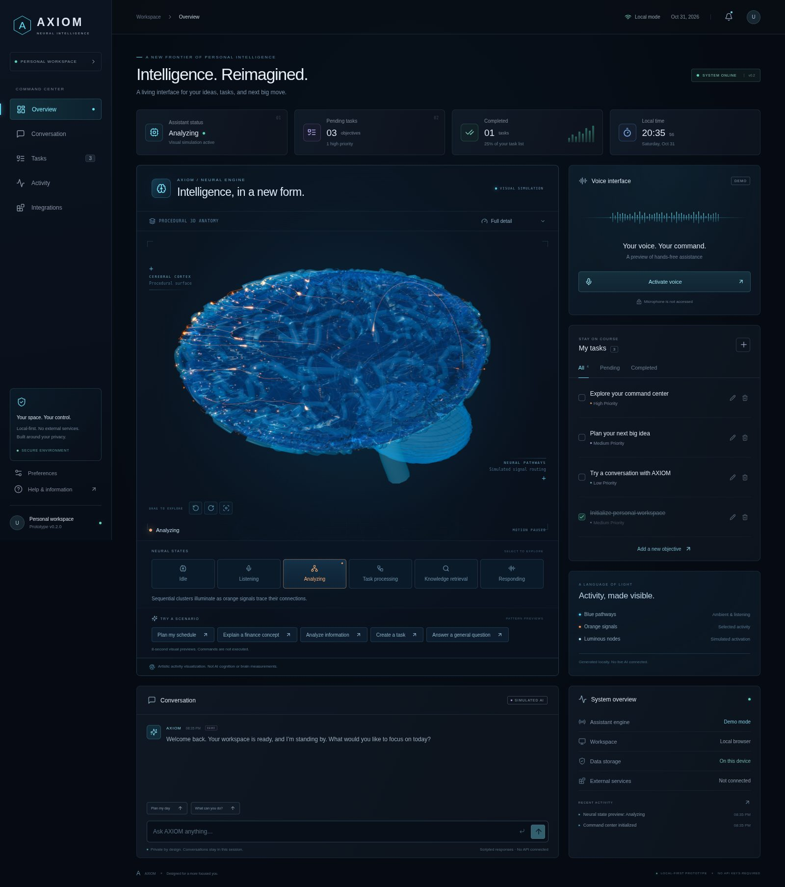

# AXIOM — Neural Intelligence Interface

**A living interface for your ideas, tasks, and next big move.**

AXIOM is the provisional identity for the personal assistant in **JARVIS-AI**. Phase 2 replaces the circular core with an interactive, original 3D human brain while retaining the React/TypeScript dashboard, local task manager, session conversation, and activity log. No API keys, accounts, backend, paid services, or microphone are required.



[Brain detail](docs/axiom-brain.jpg) · [Mobile layout](docs/axiom-mobile.jpg) · [Static fallback](docs/axiom-fallback.jpg)

## What works

- **Interactive anatomy:** drag to rotate a large, translucent blue brain, or use the keyboard-accessible rotation and reset buttons. Original folded cortical hemispheres, a medial fissure, cerebellum, stem, raised winding gyri, hundreds of luminous nodes, and blue/orange signal paths.
- **Six neural states:** Idle, Listening, Analyzing, Task processing, Knowledge retrieval, and Responding, each with a distinct visual pattern. Manual previews and five scenario buttons are available directly below the brain.
- **Reactive interface:** chat requests activate a relevant processing pattern, then a response pulse; task changes activate selected clusters; the voice demo drives blue neural pulses with a generated audio amplitude envelope.
- **Tasks:** add, edit, prioritize, complete, reopen, delete, and filter objectives. Browser local storage preserves tasks across reloads. Existing `jarvis.tasks.v1` data is retained, including task titles you already saved.
- **Conversation:** session history, typing indicator, suggested prompts, and scripted responses using actual pending tasks. Finance and analysis examples are scripted. Every assistant message is labeled as a demo.
- **Dashboard:** five navigation views, live local clock/date, actual task counts, storage status, and session activity. No fabricated computer-performance or cognition measurements.
- **Accessibility and resilience:** reduced-motion support, session animation preference, Eco mode, static anatomy without WebGL, and automatic fallback if the graphics context is lost. Task and conversation controls keep working.

**All assistant responses and neural patterns are simulations.** These artistic patterns represent application activity; they are not real AI cognition, brain scans, neuroscience findings, or clinical anatomy. No microphone is accessed and no audio is recorded.

## Preview

Prerequisite: Node.js 22.12+ or Node.js 24 LTS with npm. These commands install project dependencies only; no administrator access or system-wide installation is needed.

```bash
git clone https://github.com/Converge20/JARVIS-AI.git
cd JARVIS-AI
git checkout feat/axiom-neural-interface
npm ci
npm run dev
```

Open **http://localhost:5173**. The script binds to `0.0.0.0` for cloud-workspace previews. Use `npm run dev -- --host 127.0.0.1` to restrict a personal preview to your machine.

```bash
npm run build       # TypeScript validation + production bundle in dist/
npm run preview     # Production preview at http://localhost:4173
npm test            # Service, geometry, state-machine, and React tests
npm run test:e2e    # Chromium browser workflows, including actual WebGL rendering
```

For browser tests, install the development browser with `npx playwright install chromium`, or set `PLAYWRIGHT_CHROMIUM_EXECUTABLE_PATH=/path/to/chromium` if it is already installed. Test-only software-rendering flags make shaders testable on CI without a physical GPU. These flags are not used by the application. CI runs on an ephemeral Ubuntu runner; it installs nothing on your Mac.

## Try every neural state

Select a state under **Neural states**. Each non-idle manual preview lasts eight seconds, then returns to Idle; selecting a new state replaces the previous preview.

| State               | Visual behavior                                                    | Also triggered by                            |
| ------------------- | ------------------------------------------------------------------ | -------------------------------------------- |
| Idle                | Soft blue pulses, sparse signal packets, gentle orientation drift  | Preview expiry or the Idle button            |
| Listening           | Bright blue nodes follow a synthetic amplitude envelope            | Activate voice; stops after eight seconds    |
| Analyzing           | Orange packets and sequential spatial cluster activation           | An analysis or comparison chat prompt        |
| Task processing     | Concentrated orange activity around a selected cluster             | Task changes, briefly; planning/task prompts |
| Knowledge retrieval | Blue/orange activity across distributed clusters                   | Explanation, finance, and knowledge prompts  |
| Responding          | Synchronized rhythmic neural lights and a simulated voice waveform | Completion of a scripted chat reply          |

The five **scenario buttons** are visual previews, not command execution:

- **Plan my schedule:** forward-cluster task pattern.
- **Explain a finance concept:** distributed retrieval pattern.
- **Analyze information:** sequential analysis pattern.
- **Create a task:** a different, posterior task cluster.
- **Answer a general question:** rhythmic response pattern.

Create actual tasks through **My tasks → +**. Chat through **Conversation** or press `⌘/Ctrl + K`. Scripted replies cannot perform external actions. A delayed chat response cannot override a newer manual preview or task/voice action.

Use **Visual quality** above the brain to select **Full detail**, **Eco**, or **Static**. Under Preferences, turn **Ambient animations** off to pause motion. The operating system's reduced-motion preference also pauses the 3D animation, including signal travel, while keeping the selected state's appearance visible.

## How the brain is built

No model, texture, HDR environment, font, or other asset is downloaded at runtime. The anatomy and pathways are authored procedurally in this repository.

1. `geometry.ts` generates two mirrored, elongated half-surfaces with a medial gap, temporal shaping, domain-warped sulci, and smaller cerebellar/stem geometry. Raised meandering gyri form a single merged tube mesh rather than dozens of individual draw calls.
2. Three.js and React Three Fiber render physically lit, translucent blue surfaces with a custom Fresnel rim shader. An atmospheric background provides a subtle depth/glow effect without a heavy bloom or volumetric postprocessing stack.
3. A seeded generator places **960 cortical nodes in Full detail** or **480 in Eco**. Six spatial clusters provide repeatable visual routing; these clusters have no asserted cognitive meaning.
4. Vertex/fragment shaders compute node brightness and blue/orange colors from the selected mode, synthetic amplitude, cluster, and time. Small packet trails move along precomputed Catmull–Rom curves; their buffers are updated in place without React updates per frame.
5. The renderer is loaded lazily only when WebGL is available and selected. The fallback projects the same procedural geometry into SVG and uses no WebGL or animation loop.

## Performance and limits

- Full-detail active states request up to 60 frames per second. Idle and Eco request up to 30. Device pixel ratio is capped at 1.5 in Full detail and 1 in Eco.
- Rendering stops when the tab is hidden, the scene is outside the viewport, motion is disabled, or reduced motion is requested. Explicit state and rotation changes still render a single frame.
- Eco reduces cortical mesh resolution, nodes, pathways, gyri detail, and antialiasing. Static view avoids GPU rendering completely. A lost context automatically switches to the static view; **Retry 3D** attempts recovery.
- Shader geometry is allocated once per quality setting, reused between frames, and disposed when replaced/unmounted. No runtime analytics, external assets, shadows, AI API calls, or expensive postprocessing are used.
- The approximate anatomy is an artistic model, not a segmented human scan. The glow uses surface shading and compositing, not physical volumetric simulation.
- A smooth 60 FPS is a target, not a measured guarantee. Validation here uses Chromium with a software WebGL renderer, not physical macOS Chrome hardware. Integrated GPUs, high-resolution displays, power-saving modes, and other tabs can reduce performance. Use Eco or Static as needed.
- Three.js adds an approximately 242 KB gzip lazy-loaded renderer chunk. Vite reports its normal 500 KB uncompressed chunk advisory; the main interface and static fallback remain separate and usable without loading the renderer.

## Architecture and branding

```text
src/
  config/brand.ts             Provisional assistant name, monogram, tagline, version, repo URL
  App.tsx                     Dashboard, navigation, task/chat activity integration
  components/
    neural/
      geometry.ts             Original procedural anatomy, nodes, curves, SVG projection
      activity.ts             Six mode definitions, scenario profiles, synthetic amplitude
      BrainScene.tsx          Lazy-loaded Three.js / React Three Fiber renderer and shaders
      BrainFallback.tsx       Static SVG projection without WebGL
      NeuralPanel.tsx         Controls, render policy, context/error fallback
      neural.css              Cinematic layout and neural interface styles
    Chat.tsx                  Session conversation and composer
    Tasks.tsx                 Persistent task UI and editor
    Waveform.tsx              Simulated voice waveform
  hooks/useNeuralActivity.ts  Timed modes, interruption-safe reply transitions, cleanup
  hooks/useTasks.ts           Task persistence and storage error handling
  services/assistant.ts      AssistantProvider boundary and scripted responses
  services/tasks.ts          Stable versioned task storage and validation
```

Change `src/config/brand.ts` to rename the assistant across the interface, message labels, shortcut, browser title, and new onboarding tasks. The static HTML metadata/favicon and documentation can be updated for a final identity. Saved user task titles are never silently renamed. The repository remains `Converge20/JARVIS-AI` and storage keys stay stable.

Dependencies are React, React DOM, Lucide icons, Three.js, and React Three Fiber. There is no additional controls, animation, asset-loader, or postprocessing library.

## Data, security, and next steps

- Tasks remain on this browser origin under `jarvis.tasks.v1`. They are not encrypted or synced; avoid storing secrets. Clearing site data deletes them.
- Conversation, activity, neural previews, visual quality, and animation preferences are session-only.
- Invalid saved data is preserved until the user explicitly chooses replacement. Blocked/full browser storage produces a visible session-only warning.
- No microphone, paid APIs, key requests, email/calendar connections, device automation, or telemetry. `.gitignore` excludes secrets, dependencies, builds, and test artifacts. No deployment workflow is included.
- Future AI providers must call a protected backend. Never put keys in browser code or `VITE_*` variables. `AssistantProvider.reply(prompt, context)` is the integration boundary.
- Calendar, email, real voice, reminders, weather, optional memory, and approved Mac controls remain future work. Sensitive actions must use scoped permissions and explicit approval.
- Phase 2 is prepared on its own feature branch for review. Nothing is deployed or automatically merged into `main`.

## Validation

Vitest covers valid/invalid storage, task lifecycle and persistence, scripted replies, voice/preferences, procedural mesh invariants, deterministic nodes, scenario routing, timed state transitions, and stale-reply protection. Playwright verifies task persistence across real reloads, all navigation, chat/voice, responsive overflow, actual rendered blue and orange WebGL pixels, every neural mode/scenario, context-loss recovery, no-WebGL operation, and paused draw calls under reduced motion.
