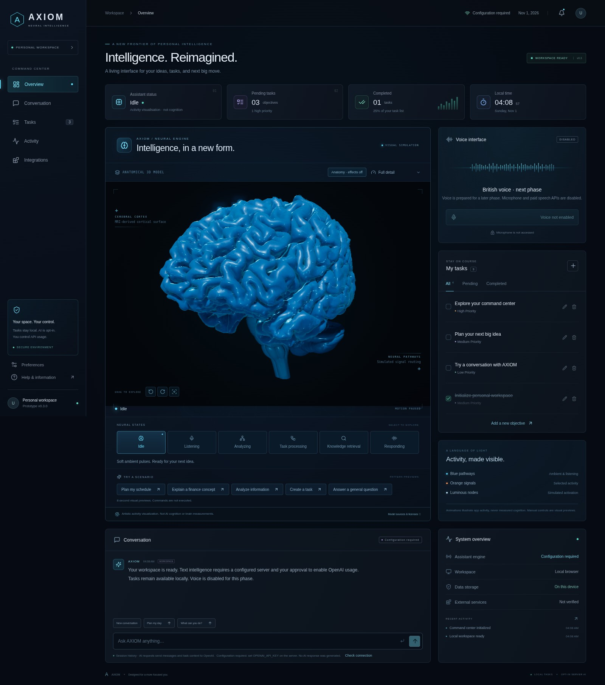

# AXIOM — Personal Intelligence Interface

A personal assistant with opt-in, server-backed Groq text intelligence in **Converge20/JARVIS-AI**, built with React, TypeScript, Vite, Three.js, and React Three Fiber. AXIOM is a provisional name, configurable in `src/config/brand.ts`.



[Effects-off anatomy](docs/axiom-anatomy.jpg) · [Neutral side view](docs/axiom-anatomy-side.jpg) · [Brain detail](docs/axiom-brain.jpg) · [Mobile](docs/axiom-mobile.jpg) · [Visual validation](docs/ANATOMY-VALIDATION.md)

## Anatomical correction

The former parametric oval has been removed. The brain now uses licensed anatomical meshes:

- **Cortex:** MRI-derived bilateral pial surface from OpenNeuro ds006128, sub-01, snapshot 1.0.11 (**CC0 1.0**), via a pinned anatomical atlas. Full detail preserves all **150,256 native cortical triangles** and genuine hemispheric variation.
- **Cerebellum and stem:** separate BodyParts3D (**CC BY 4.0**) cerebellum, midbrain, pons, and medulla meshes, aligned with the cortex by a recorded uniform transformation.
- **Honest scope:** this is a multi-source anatomical composite, not a single-subject reconstruction or clinical model. The lower structures are less detailed than the MRI cortex. No ellipsoid, synthetic gyri, sphere cerebellum, or tube stem is used.

**BodyParts3D, © The Database Center for Life Science licensed under CC Attribution 4.0 International.**

Complete source URLs, authors, licenses, pinned revisions, adaptation notices, and checksum records are retained in [model attribution](public/models/ATTRIBUTION.md), `licenses/anatomy/`, and `public/models/provenance.json`. Those data credits also apply to derived screenshots. No application code from the source anatomy viewers is copied.

## Working features

- Large, rotatable anatomical brain with blue materials, fold shading, real self-shadows, restrained bloom, luminous nodes, and surface-following blue/orange signal packets.
- **Anatomy · effects off:** inspect the exact same geometry in opaque gray with neutral lighting. Every node, path, glow, and bloom layer is removed, so the silhouette and folds can be checked directly.
- Six neural visual previews and five manual scenarios, preserved alongside real activity: Analyzing while awaiting Groq, task activity after applying changes, and a short acknowledgement after an actual local task retrieval tool returns. A late reply cannot override a newer preview.
- Full task management: add, edit, prioritize, complete, reopen, delete, and filter. Saved `jarvis.tasks.v1` data remains compatible across refreshes. Existing task titles are preserved.
- Real Groq text responses with recent multi-turn context, connection/configuration/error feedback, and no scripted fallback. Natural-language task tools retrieve the list or propose a dated task, completion, edit or deletion. Every AI mutation requires an explicit confirmation; stale proposals are rejected.
- Five navigation views, a live local clock/date, actual task summaries, storage status, and a session activity log.
- Responsive layouts, keyboard controls, reduced-motion support, a session animation preference, Eco mode, Static fallback, and recovery from WebGL context loss.

Neural graphics are an **illustration of application activity**, never a measurement of cognition or real neural tracts. Manual state/scenario controls are explicitly visual demonstrations. Real AI text requires server configuration and explicit opt-in. No microphone is accessed and no audio is recorded or generated.

## Run and test

Use Node.js 24 LTS (or Node 22.12+) with npm. The dashboard and local task manager work without keys. Real AI requires your GroqCloud free-tier project key and approved API usage. No administrator permissions are required.

```bash
git clone https://github.com/Converge20/JARVIS-AI.git
cd JARVIS-AI
git checkout feat/axiom-neural-interface
npm ci
cp .env.example .env  # optional: defaults keep AI disabled
npm run dev
```

Open **http://localhost:5173** on the development machine. `npm run dev` starts Vite and a loopback-only Node backend on port 3001; Vite forwards `/api` to it. In Codespaces, use its authenticated **Private** forwarded port 5173 instead of your Mac’s localhost. Do not expose port 3001 separately. See [Phase 3B setup and safeguards](docs/PHASE-3B-GROQ.md).

```bash
npm run build       # TypeScript + production bundle in dist/
npm start           # Serves dist/ AND /api on http://127.0.0.1:3001
npm run preview     # Frontend-only Vite preview; no AI backend proxy
npm test            # Asset, geometry, routing, service, state, and React tests
npm run test:e2e    # Chromium workflows and real WebGL validation
```

Install the development browser with `npx playwright install chromium`, or set `PLAYWRIGHT_CHROMIUM_EXECUTABLE_PATH=/path/to/chromium` to an installed binary. CI uses test-only software WebGL flags on an ephemeral runner, not on your Mac. The application itself does not require those flags or any system-wide installation.

## Try every visual state

Use the six buttons beneath the brain. Non-idle manual previews last eight seconds, then return to Idle. The five scenario buttons preview patterns only; they do not execute commands.

| State               | Visual behavior / trigger                                                                                     |
| ------------------- | ------------------------------------------------------------------------------------------------------------- |
| Idle                | Sparse blue pulses and gentle orientation drift.                                                              |
| Listening           | Manual visual preview only. Real listening is disabled until microphone/voice integration is approved.        |
| Analyzing           | Orange processing pattern during an actual AI request; also available as a manual visual preview.             |
| Task processing     | Focused clusters on real task changes, including confirmed AI proposals; manual preview also available.       |
| Knowledge retrieval | Acknowledgement after a real local task-list tool returns; manual preview also available. No web-search tool. |
| Responding          | Manual visual preview only. Text responses return to Idle; real audio synchronisation is planned.             |

Scenario profiles: Plan my schedule → task cluster A; Explain a finance concept → retrieval; Analyze information → sequential analysis; Create a task → a different task cluster D; Answer a general question → responding. Create actual tasks through the Tasks panel or a confirmed AI task proposal. `⌘/Ctrl + K` opens conversation.

Select **Anatomy · effects off** to validate the shape independently of lighting effects. Use **Visual quality** for Full detail, Eco, or Static. Preferences → Ambient animations pauses motion; the operating system's reduced-motion preference also stops the animation loop.

## Rendering and performance

- Full detail: approximately 244,000 triangles across the five anatomical meshes, 640 nodes, and 37 cortical edge routes. Eco uses about 93,000 triangles, 320 nodes, 19 routes, a lower pixel ratio, and no bloom or shadow pass.
- The renderer is lazy-loaded. Full active states request up to 60 frames/second; Idle and Eco request up to 30. Rendering stops when hidden/offscreen, paused, or under reduced motion. Explicit changes still render a single frame.
- Actual mesh normals and native cortical curvature support fold shading. A small high-threshold bloom pass uses Three.js's own modules; no new postprocessing framework is added. Full-detail self-shadows provide depth without replacing the anatomical silhouette.
- Signal routes are precomputed with A* on the triangle-edge graph. Packet positions update in place with arc-length/linear edge interpolation. They cannot take Catmull–Rom shortcuts through sulci or across empty space.
- Compressed local GLB assets load only for 3D: roughly 4.46 MB Full detail or 1.73 MB Eco, plus their small network file. Modern desktop Chrome supports the native gzip decompression API used by the loader. No external model/texture requests occur at runtime.
- Static/no-WebGL mode displays a render of the same licensed composite. Loading/render failures and context loss preserve the working dashboard and offer a retry. Intentional Static/Eco/Full changes do not create false failure messages.
- The lazy Three.js renderer is about 258 KB gzip and produces Vite's standard uncompressed chunk-size advisory. 60 FPS has not been benchmarked on physical macOS hardware; software WebGL, high-DPI displays, and power-saving modes can be slower. Eco/Static are available to reduce load.

## Architecture and reproducible data pipeline

```text
src/config/brand.ts                    Provisional branding
src/components/neural/BrainScene.tsx    Licensed mesh rendering, shadows, bloom, and signals
src/components/neural/anatomy-loader.ts Local compressed GLB + network loading and cache
src/components/neural/geometry.ts      Mesh-edge arc-length interpolation; no brain generator
src/components/neural/NeuralPanel.tsx   State controls, anatomy inspection, quality, fallback
src/components/neural/BrainFallback.tsx Static render of the same anatomy
src/components/neural/activity.ts      State/scenario definitions and synthetic amplitude
src/hooks/useNeuralActivity.ts          Timed modes and interruption-safe reply transitions
public/models/                         Licensed assets, LODs, routes, attribution, provenance
licenses/anatomy/                      Original source notices, metadata, and license snapshot
scripts/build-anatomy.py               AXIOM's own checksum-verified offline conversion
scripts/requirements-anatomy.txt        Development-only data pipeline dependencies
```

Anatomical sources are fetched only during development. `scripts/build-anatomy.py` verifies the two input SHA-256 hashes before extracting geometry, applies the documented registration, retains the native Full-detail cortex, makes a separate Eco decimation, and generates a surface network for **each** LOD. Runtime and normal app development need neither Python nor the original sources. The script expects the pinned GLB inputs at the `work/anatomy/` paths documented in `public/models/provenance.json`; sources and URLs are in the attribution. Original downloads stay ignored under `work/`.

For optional regeneration in an isolated development environment, install `scripts/requirements-anatomy.txt` there and run `python scripts/build-anatomy.py`. Never install development tools on a user's machine automatically. Dataset code/credits do not relicense unrelated application code.

## Data, security, and future work

Tasks stay in the current browser origin's local storage. They are not encrypted or synced; clearing site data deletes them. Invalid saved data is preserved until the user explicitly replaces it; blocked/full storage produces a visible session-only warning. Conversation, activity, previews, and preferences are session-only.

The backend uses Groq’s OpenAI-compatible Responses API through the existing SDK (`openai/gpt-oss-20b` by default, configurable with `GROQ_MODEL`). All provider requests go to `https://api.groq.com/openai/v1`; there is no OpenAI fallback. It stays disabled unless server-side `GROQ_API_KEY` is configured **and** `GROQ_ENABLED=true` is explicitly set. Never use a `VITE_*` credential variable. `.env.example` contains placeholders only; `.gitignore` excludes real environment files. No real API calls are made by tests.

Voice transport/event interfaces, original British voice direction, and session-only future voice selection are prepared, but speech APIs, microphone access, transcription and audio output are **not implemented or enabled**. No calendar/email connections, telemetry, device controls or deployment workflow is added. Current setup, usage safeguards, data flow and limitations: [Phase 3B — Groq](docs/PHASE-3B-GROQ.md).

Changes remain on a draft review branch. Nothing is automatically merged into `main` or deployed.

Dependency security review and audit evidence: [dependency audit](docs/security/DEPENDENCY-AUDIT.md).
